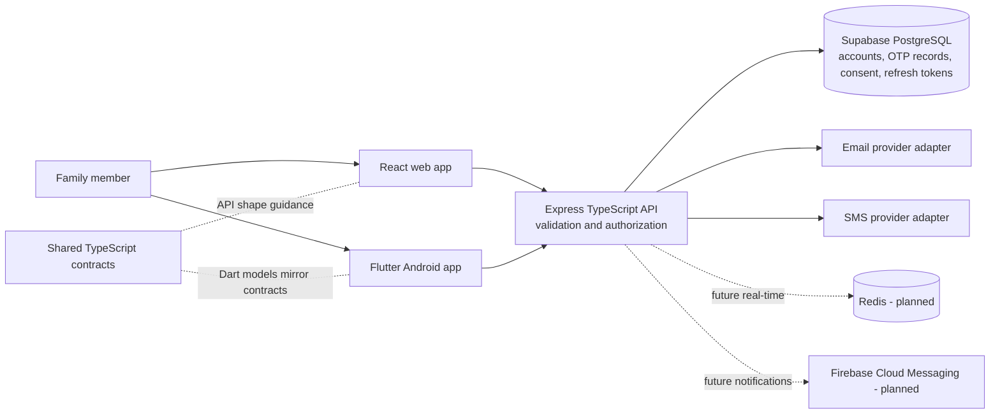

# System architecture

## Phase 2 boundaries

FamShield is organized as a web client, Flutter Android client, API service, and shared
TypeScript-contract package. The API uses Supabase PostgreSQL through Drizzle/node-postgres for
accounts, verification, consent records, and refresh-token sessions. Registration,
dual-channel verification, sign-in,
session management, password reset, and self-profile operations are implemented. Family groups,
location processing, Redis, push notifications, and real-time sockets remain future work; no
location collection or tracking path exists.

## Trust boundaries

- Clients communicate with the API over HTTPS in production.
- The API validates configuration at startup and limits browser origins through `CORS_ORIGINS`.
- Profile and session operations require authentication and are scoped to the current account.
- Browser authentication uses HttpOnly SameSite cookies and CSRF protection; Flutter stores tokens
  in platform secure storage.
- OTPs and refresh tokens are stored as keyed hashes, never as plaintext.
- Location data must never be public, and secrets or precise coordinates must not enter logs.
- Health responses disclose service/database readiness only, not connection strings or credentials.

## Planned evolution

Family authorization must precede any sensitive family or location endpoint. Location sharing must
be opt-in, visible, pausable, and revocable by the person sharing. Account Terms/Privacy acceptance
is not location consent. See
[`../security/security-principles.md`](../security/security-principles.md).
